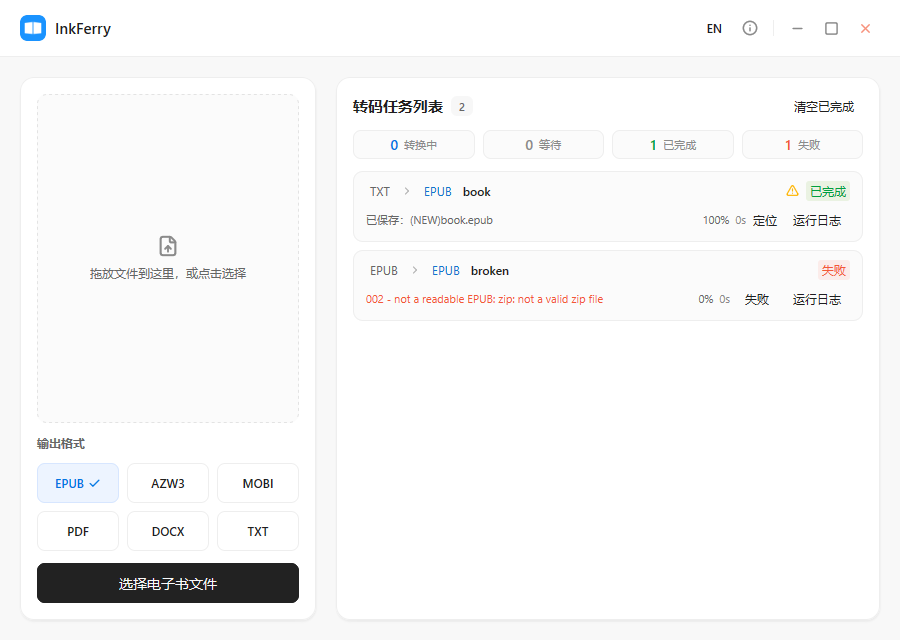

<div align="center">

# InkFerry · 墨渡

**轻量、原生的电子书格式转换器。**

EPUB ⇄ MOBI / AZW3、PDF、DOCX、TXT，一个不到 20 MB 的可执行文件。

[](https://github.com/lllll081926i/inkferry/releases/latest)
[](https://github.com/lllll081926i/inkferry/actions/workflows/ci.yml)
[](https://go.dev)
[](LICENSE)

[下载](#下载) · [功能](#功能) · [构建](#从源码构建) · [命令行](#命令行) · [常见问题](#已知边界)

</div>



## 为什么是 InkFerry

大多数电子书转换工具会把一整套浏览器运行时塞进安装包，启动慢、体积大，界面却只用来选几个文件。

InkFerry 换了一条路：

- **原生界面**：用 [MyGo](https://github.com/egoist/mygo) 直接绘制，没有 Electron、Chromium、WebView 或 JavaScript 运行时。
- **单文件运行**：主程序约 18 MB，解压即可使用，不写注册表，不需要安装器。
- **本地转换**：文件不上传、不联网、不埋点。转码引擎就在进程里。
- **真正可用**：拖放、批量队列、三任务并发、取消、进度、运行日志和结果定位都在。

## 功能

| | |
|---|---|
| **拖放即转** | 文件拖进窗口，或点一下选择文件，立即加入队列。 |
| **六种目标格式** | EPUB、AZW3、MOBI、PDF、DOCX、TXT。 |
| **并发队列** | 默认同时转换 3 个任务；其余任务排队，可随时终止。 |
| **安全的输出** | 默认写入源文件目录，前缀 `(NEW)`；遇到重名自动编号，绝不覆盖已有文件。 |
| **转换日志** | 每个任务都能展开查看实时日志；失败时给出诊断信息和原因分类。 |
| **中英双语** | 跟随系统语言，也可用 `-lang` 强制指定。 |
| **键盘与辅助技术** | 所有主要控件都有可访问名称和选中状态。 |
| **跨平台构建** | Windows x64 / ARM64、Linux x64、macOS Apple Silicon。 |

## 下载

前往 [Releases](https://github.com/lllll081926i/inkferry/releases/latest) 下载最新版本：

| 平台 | 文件 |
|---|---|
| Windows x64 | `InkFerry-<version>-windows-amd64.zip` |
| Windows ARM64 | `InkFerry-<version>-windows-arm64.zip` |
| Linux x64 | `InkFerry-<version>-linux-amd64.tar.gz` |
| macOS Apple Silicon | `InkFerry-<version>-macos-arm64.tar.gz` |

每个压缩包都包含图形界面 `InkFerry`、批处理命令行 `ferry`、组件安装工具 `ferryinstall`、README、更新日志和许可证。下载页同时提供 `SHA256SUMS.txt`。

> **macOS 提示**：当前发布包没有 Apple 开发者签名。首次运行前可能需要在“系统设置 → 隐私与安全性”中允许，或对解压后的可执行文件执行 `xattr -dr com.apple.quarantine inkferry`。

## 支持的格式

| 输入 | 内置引擎输出 | 需要可选 Calibre 组件 |
|---|---|---|
| EPUB、MOBI、AZW、AZW3 | EPUB、PDF、DOCX、TXT | MOBI、AZW3 |
| PDF、DOCX、TXT | EPUB、PDF、DOCX、TXT | MOBI、AZW3 |

- **内置引擎**负责文本抽取、章节重建和 EPUB / PDF / DOCX / TXT 写出，不需要额外安装任何东西。
- **MOBI / AZW3 输出**使用可选的 Calibre 桥接组件。运行 `ferryinstall` 即可安装；发布包中已附带该工具。
- PDF 输出是按正文重新排版，不保留原书的复杂版式；这与多数同类转换器的行为一致。

## 使用

1. 打开 InkFerry。
2. 在左侧选择目标格式。
3. 把电子书拖进窗口，或点击“选择电子书文件”。
4. 在右侧查看进度；完成后点“定位”打开输出文件所在目录。

输出文件默认与源文件放在同一目录，命名为 `(NEW)原文件名.扩展名`。如果同名文件已存在，会自动使用 `(2)`、`(3)` 等编号。

### 启动参数

```text
inkferry                      打开图形界面
inkferry -lang zh-cn          强制中文
inkferry -lang en-us          强制英文
inkferry -font <font.ttf>     系统缺少中文字体时手动指定字体
inkferry -to epub a.txt b.pdf 启动后立即把文件加入队列
```

## 命令行

图形界面之外还有两个小工具，使用同一个转换引擎。

### `ferry`：无界面批量转换

```bash
# 转成 EPUB
ferry -to epub book.pdf notes.docx

# 转成 PDF
ferry -to pdf book.epub

# 支持的目标格式：epub, mobi, azw3, pdf, txt, docx
```

`ferry` 会等到所有任务结束，逐行打印状态；任一任务失败时以非零状态退出，适合放进脚本或 CI。

### `ferryinstall`：安装可选组件

```bash
ferryinstall
```

组件保存在系统配置目录下的 `InkFerry` 文件夹中。Windows 上通常是 `%APPDATA%\InkFerry`。

## 从源码构建

### 环境要求

- Go **1.27.3** 或更高版本
- 无需 Node.js、npm、CGO 或平台 SDK
- 打包脚本需要 `bash`；GitHub Actions 使用 Ubuntu 和 `zip`

### 本地构建

```bash
git clone https://github.com/lllll081926i/inkferry.git
cd inkferry

make test          # 引擎 + 界面测试
make all           # 构建 Windows、Linux、macOS
make package VERSION=v1.0.0
```

`make all` 的产物位于 `dist/`。`make package` 会重新构建全部平台，并在 `dist/release/` 生成可直接上传到 GitHub Release 的压缩包和校验和。

单独构建当前平台：

```bash
go build -trimpath -ldflags "-s -w" -o inkferry .
go build -trimpath -ldflags "-s -w" -o ferry ./cmd/ferry
go build -trimpath -ldflags "-s -w" -o ferryinstall ./cmd/ferryinstall
```

Windows 图形界面构建需要 `-H windowsgui`，仓库自带的 `rsrc_windows_*.syso` 会提供图标。

### 发布流程

```bash
git tag v1.0.0
git push origin v1.0.0
```

推送 `v*` 标签后，[Release 工作流](.github/workflows/release.yml) 会自动：

1. 在干净的 Ubuntu 环境中运行测试；
2. 交叉编译四个目标平台；
3. 生成 ZIP / tar.gz 和 `SHA256SUMS.txt`；
4. 创建 GitHub Release 并上传全部产物。

也可以在 Actions 页面手动运行 Release 工作流，填入一个已经存在的标签。

## 技术实现

```text
main.go                 桌面入口、窗口和启动参数
internal/app/           MyGo 界面、状态与交互
internal/engine/        格式解析、转换、PDF 排版与任务队列
internal/i18n/          中英文文案
cmd/ferry/              无界面批量转换
cmd/ferryinstall/       可选组件安装器
scripts/package.sh      本地与云端共用的打包脚本
```

- **界面**：MyGo 原生 GPU 绘制；Lobe MyGo 提供按钮、进度条、弹窗等组件。
- **引擎**：EPUB 使用 zip + OPF spine；MOBI / AZW3 使用 PalmDOC / KF8 解析；PDF 使用 `ledongthuc/pdf`；DOCX 直接读取 OOXML；写出使用标准容器格式和 `signintech/gopdf`。
- **并发**：任务队列使用固定工作槽和可取消上下文，每个任务拥有独立的临时目录。
- **安全**：输出文件排他创建，重名自动避让；取消后不留下半成品；不覆盖原文件。

## 测试

```bash
make test
go test -race ./internal/engine ./internal/app
go vet ./...
```

测试覆盖真实文件转换、容器结构校验、坏文件拒绝、编码探测、并发重名、任务取消、窗口布局和中英文界面。

界面测试使用 MyGo 的无头 Tester 构建真实帧。设置 `NC_UI_SNAPSHOT_DIR` 后运行：

```bash
NC_UI_SNAPSHOT_DIR=./snapshots go test ./internal/app -count=1
```

会导出浅色、深色、英文、手机尺寸和真实任务列表截图。

## 已知边界

- **DRM 不处理。** 受 DRM 保护的书需要先通过合法方式移除保护。
- **HUFF 压缩的 MOBI** 少数 Kindle 文件内置解析器不支持，会明确提示改用 Calibre。
- **PDF 是文本重排**，不保留复杂排版、图片位置和原书分页。
- **Windows 32 位不支持**，因为底层界面栈只提供 amd64 / arm64。
- **macOS 发布包未签名、未公证**；企业分发前应自行签名。
- 翻译质量与格式还原度取决于源文件质量；损坏的文件不会被静默“修复”。

## 隐私

InkFerry 不上传文件、不包含分析 SDK、不生成设备标识。转换完全在本机完成。只有在你主动安装可选组件时，程序才会访问对应的下载地址。

## 致谢

- [MyGo](https://github.com/egoist/mygo) — 原生 Go UI
- [Lobe MyGo](https://github.com/lobehub/lobe-mygo) — 组件与设计语言
- [Calibre](https://calibre-ebook.com/) — 可选的 MOBI / AZW3 转换桥接
- [Noto Sans SC](https://github.com/notofonts/noto-cjk) — PDF 内嵌字体子集（SIL Open Font License 1.1）
- 以及 `go.sum` 中列出的所有开源依赖

InkFerry 是独立开源项目，与 Neat Reader、Calibre 官方均无隶属关系。产品名称和商标归各自所有者所有。

## 许可证

源代码以 [MIT License](LICENSE) 发布。内置的 Noto Sans SC 字体子集遵循 SIL Open Font License 1.1；第三方依赖遵循各自许可证。
